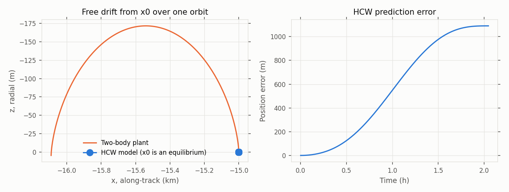
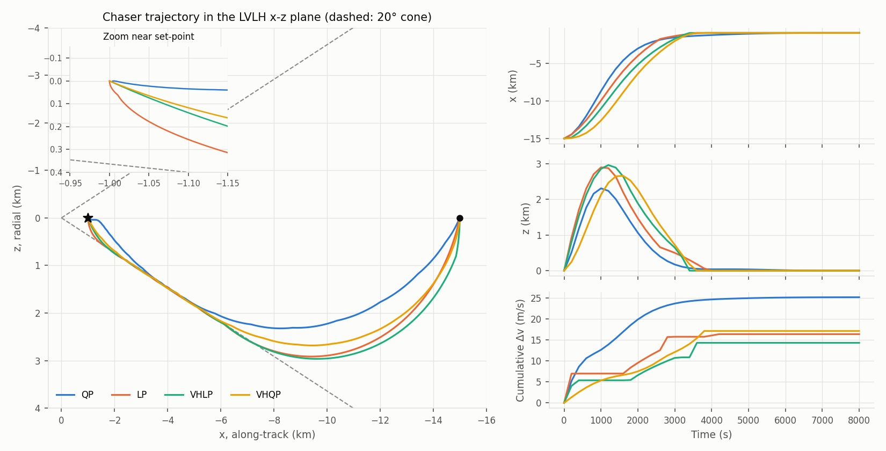
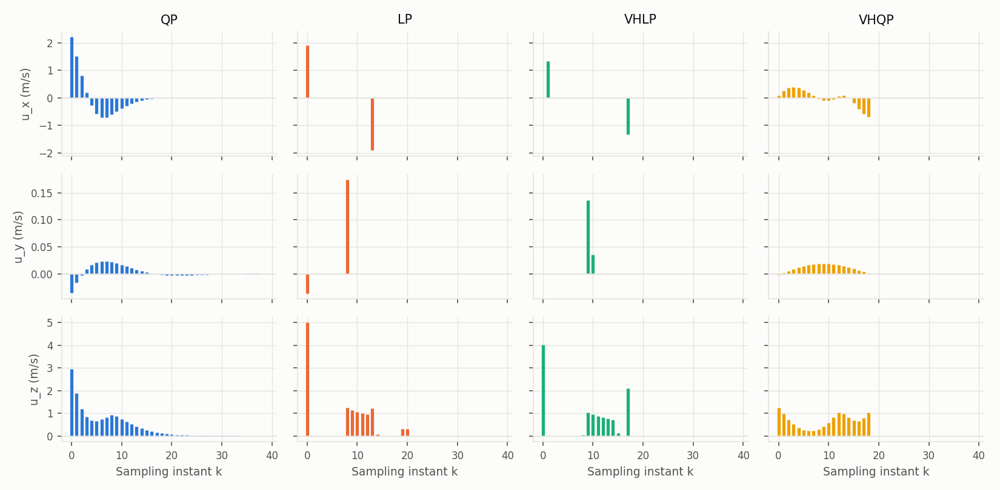
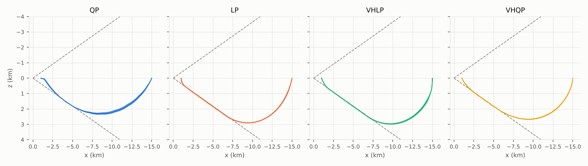
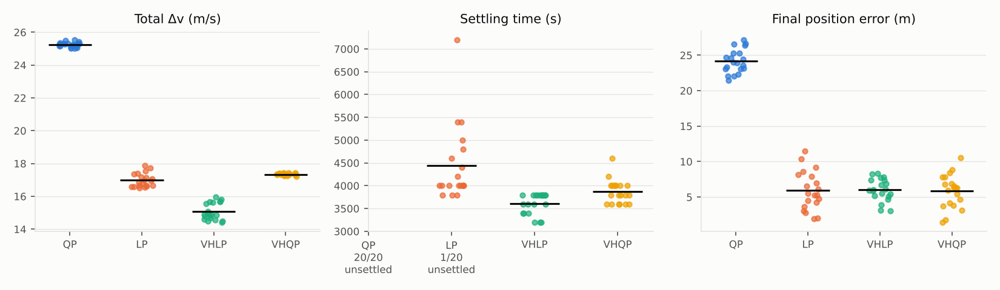

# Model Predictive Control for Spacecraft Rendezvous

A study of model predictive control (MPC) for the far-to-close
range phase of a spacecraft rendezvous, built on the tutorial by
Hartley (2015).

This study re-creates the experiment of the paper (four MPC cost
functions transferring a chaser from 15 km to 1 km behind a target) and then tests the same controllers against a more realistic plant: exact two-body dynamics, navigation noise, a thruster minimum impulse bit and thrust execution errors.

---

## Objective

Design, implement and compare four MPC controllers that bring the chaser to a hold point 1 km behind the target while

* respecting a per-axis impulse limit of 5 m/s,
* staying inside a 20° visibility (approach) cone,
* converging in about half an orbit,

and quantify the trade-off between fuel, time, accuracy and
constraint satisfaction, first in nominal conditions and then under
model mismatch and uncertainty.

---

## Scenario Description

| Item | Value |
|---|---|
| Central body | Mars, μ = 4.2828·10¹³ m³/s² |
| Target orbit | Circular, 500 km altitude, n = 8.53·10⁻⁴ rad/s, T = 7365 s |
| Frame | Target LVLH (Fehse): x along-track, y = −orbit normal, z towards Mars |
| Initial state | x₀ = [−15 000, 200, 0] m, zero relative velocity |
| Set-point | x_s = [−1 000, 0, 0] m, zero relative velocity (a V-bar equilibrium) |
| Sampling period | Ts = 200 s, simulated for 40 steps (8 000 s ≈ 1.1 orbits) |
| Input | Impulsive Δv, \|Δv_p\| ≤ 5 m/s on each axis |
| Approach cone | Half-angle 20°, apex on the target, approach from behind |

---

## Methodology

### Prediction Model

The model is the linearised Hill-Clohessy-Wiltshire (HCW) equations:

```
x'' = 2n z'          y'' = -n² y          z'' = 3n² z - 2n x'
```

They are discretised with impulsive inputs. The impulse changes the velocity at the start of each period and the chaser then drifts freely:

```
x(k+1) = Φ(Ts) (x(k) + [0; I] u(k))   →   A = Φ(Ts),  B = Φ(Ts) [0; I]
```

### Constraints

* **Input bounds**, eq. (6b): `−u_max ≤ u_p ≤ u_max`, p ∈ {x, y, z}.
* **Visibility cone**, eq. (8): `±z + x tanγ ≤ 0`, `±y + x tanγ ≤ 0`.
  - It is softened with non-negative slacks and an exact 1-norm penalty
    (ρ = 100).
  - The optimisation therefore never becomes infeasible because of the cone.
* **Terminal set** (variable-horizon controllers only): `x_N ∈ T`.

### Controllers

| Name | Horizon | Cost | Paper eq. |
|---|---|---|---|
| **QP** | Fixed, N = 30 | `Σ ‖x−x_s‖²_Q + ‖u‖²_R + ‖x_N−x_s‖²_P`, P from the Riccati equation | (10) |
| **LP** | Fixed, N = 30 | `Σ ‖Q(x−x_s)‖₁ + ‖Ru‖₁ + ‖P(x_N−x_s)‖₁` | (11) |
| **VHLP** | Variable, N ≤ 30 | `Σ (1 + ‖Ru‖₁)`, subject to `x_N ∈ T` | (15a) |
| **VHQP** | Variable, N ≤ 30 | `Σ (1 + u'Ru)`, subject to `x_N ∈ T` | (15b) |

Implementation notes:

* **Building and solving.** Every problem is built once in CVXPY with the
  state estimate as a parameter and solved with Clarabel.
* **Variable horizon.** It is implemented as in the paper's references
  [17], [29]: all problems with N = 1…30 are solved and the feasible one
  with the lowest cost is applied.
* **Terminal set, nominal case.** T = {x_s}, exactly as in the paper.
* **Terminal set, realistic case.** T is a box of ±5 m and ±5 mm/s around
  x_s. With a noisy estimate, the exact terminal equality would force a
  two-impulse correction at every step.
* **Tuning.** Weights were tuned by gridding (the approach of [17]) so that
  the controllers converge in roughly half an orbit. The values are in
  `rendezvous_mpc/config.py`.

| Controller | Weights |
|---|---|
| QP | Q = diag(10⁻⁶ I, 0.1 I), R = 10 I |
| LP | Q = diag(10⁻³ I, 0), R = 5 I, P = Q |
| VHLP | R = 1 |
| VHQP | R = 0.5 |

### Simulation Scenarios

1. **Nominal.** The plant is the HCW model itself, with perfect measurements
   and actuation. This reproduces the conditions of Fig. 4 in the paper.
2. **Realistic (Monte Carlo, 20 runs per controller).** The plant
   integrates the exact two-body relative motion (DOP853, relative state
   integrated directly). Each run adds:
   - **Navigation noise:** σ = 2 m in position and 2 mm/s in velocity, on
     each axis.
   - **Minimum impulse bit (MIB):** impulses below 0.01 m/s are not
     executed.
   - **Execution error:** 3 % (1σ) relative error in impulse magnitude.

   Run *i* uses the same random seed for every controller (paired
   comparison).

---

## Metrics

| Metric | Definition |
|---|---|
| **Total Δv** | Σ_k ‖u_k‖₁ of the executed impulses (m/s). This is a proxy for propellant with axis-aligned thruster pairs. |
| **Firings** | Number of sampling instants with an impulse above 10⁻⁴ m/s. This measures sparsity. |
| **Settling time** | First time after which the position stays within ±10 m of the set-point (per axis) until the end of the run. |
| **Final error** | Euclidean position error at t = 8 000 s (m). |
| **Cone violation, sampled** | Largest distance outside the cone at the sampling instants (m). These are the points where the constraint is imposed. |
| **Cone violation, inter-sample** | Largest distance outside the cone on a fine grid (20 points per period) along the free-drift arcs (m). |
| **Solve time** | Wall-clock time of one control update. To compare with Ts = 200 s. |

---

## Results

### 1. Prediction model check



The initial state x₀ is an equilibrium of the HCW model. For the exact
dynamics it is not: a point 15 km along the local horizontal lies about 29 m
above the target orbit, so the chaser drifts backwards.

* The HCW prediction error is **1.1 m after one sampling period** and
  **1.09 km after one orbit**.
* Short-range checks are much tighter (unit test): from 100 m, the error
  stays below 0.5 m over a full orbit.

This is the long-range linearisation error the paper discusses in Sec. III.
Here it acts as a realistic, structured model-plant mismatch.

### 2. Nominal comparison (HCW plant, no uncertainty)




| Controller | Total Δv (m/s) | Firings | Settling time (s) | Final error (m) | Cone viol. sampled / inter-sample (m) | Mean solve time |
|---|---|---|---|---|---|---|
| QP   | 25.1 | 40 | 6 800 | 4.2 | 0.0 / 24.9 | 17 ms |
| LP   | 16.3 | 11 | 4 000 | 0.0 | 0.0 / 30.1 | 14 ms |
| VHLP | **14.3** | **11** | **3 400** | 0.0 | 0.0 / 25.0 | 166 ms |
| VHQP | 17.1 | 19 | 3 600 | 0.0 | 0.0 / 25.1 | 208 ms |

The qualitative behaviour of the paper's Fig. 4 is reproduced:

* **QP: smooth, then slow.** The response is smooth and fast at the start,
  but the final convergence is asymptotic. The chaser needs 6 800 s to stay
  within 10 m and keeps firing small impulses until the end. It uses the
  most Δv (25.1 m/s).
* **LP and VHLP: "bang-off-bang".** A large initial burn is followed by a
  coast. A short train of corrections then keeps the trajectory on the cone
  boundary (k ≈ 8–14), and a braking burn ends the transfer. Only
  **11 firings** are needed.
* **Variable horizon: finite-time arrival.** Both VH controllers reach the
  set-point exactly. The chosen horizon decreases by one at every step
  (18, 17, …, 1), as expected from the principle of optimality. VHLP arrives
  in 18 steps (3 600 s ≈ half an orbit) with the lowest Δv of all
  controllers.
* **Cone constraint.** It is met exactly at every sampling instant by every
  controller. Between samples, however, the free-drift arcs bulge
  **25–30 m outside** the cone wherever the trajectory rides its boundary.

### 3. Realistic comparison (Monte Carlo, 20 runs)




Mean ± standard deviation over 20 runs:

| Controller | Settled | Total Δv (m/s) | Firings | Settling time (s) | Final error (m) | Cone viol. sampled (m) | Cone viol. inter-sample (m) | Mean solve time |
|---|---|---|---|---|---|---|---|---|
| QP   | **0/20** | 25.25 ± 0.14 | 37.6 ± 0.7 | — | 24.2 ± 1.6 | 3.4 ± 2.7 | 24.4 ± 2.9 | 13 ms |
| LP   | 19/20 | 16.99 ± 0.40 | 20.0 ± 2.1 | 4 442 ± 820 | 5.9 ± 2.7 | 8.0 ± 5.0 | 32.4 ± 2.2 | 13 ms |
| VHLP | **20/20** | **15.08 ± 0.50** | 23.3 ± 2.6 | **3 610 ± 223** | 6.0 ± 1.5 | 7.5 ± 4.4 | 26.2 ± 3.1 | 171 ms |
| VHQP | 20/20 | 17.34 ± 0.06 | 27.2 ± 2.0 | 3 870 ± 247 | 5.8 ± 2.3 | 5.1 ± 3.9 | 25.8 ± 2.5 | 218 ms |

Observations:

* **All controllers tolerate a 1 km/orbit model error.** Despite the HCW
  error, the trajectories stay close to their nominal shape and the Δv
  increases by only 0.1–0.8 m/s. The receding-horizon feedback absorbs the
  mismatch.
* **QP never settles.** The cause is the minimum impulse bit: near the
  set-point the asymptotic QP commands corrections that shrink towards zero
  (at most 0.025 m/s over the last 15 steps). Those below the 0.01 m/s MIB
  are dropped, so the chaser stalls about 24 m away. A one-off check with the same seed and the MIB removed brings
  the final error down to 5.3 m. This is the MIB sensitivity that motivates
  the LASSO cost of [23].
* **The 1-norm and variable-horizon controllers are unaffected by the MIB.**
  Their impulses are few and large. LP misses the ±10 m tolerance in one
  run and settles more slowly and with more spread (±820 s).
* **VHLP is the best overall.** It has the lowest Δv, the fastest and most
  consistent arrival (3 610 ± 223 s, about half an orbit) and 100 % success.
* **VHQP is the most repeatable in fuel** (σ = 0.06 m/s), at about 15 % more
  Δv than VHLP.
* **Cone violations remain small.** With the soft cone, noise and model
  error, sampled violations are a few metres (≤ 8 m on average). They are
  small compared with the cone width (≥ 360 m beyond 1 km) and never cause
  infeasibility. Inter-sample violations stay at 25–32 m, as in the nominal
  case.
* **Computation is negligible.** The worst mean solve time is 0.22 s, about
  0.1 % of Ts. The paper's ~10 % rule of thumb for adding a one-step
  computational delay is therefore far from being reached, even for the
  30-problem variable-horizon enumeration. The first call is slower
  (≤ 1.9 s) because CVXPY compiles the problems.

---

## Conclusions

1. **The paper's design recipe works as described.** HCW prediction, input
   bounds, a soft visibility cone and a choice of cost are enough to obtain
   a constrained, fuel-aware transfer in about half an orbit. Every control
   update solves in milliseconds to tenths of a second.
2. **The cost function shapes the behaviour more than the weights do.**
   - Quadratic costs give smooth, continuous thrusting but slow asymptotic
     convergence.
   - 1-norm costs give sparse "bang-off-bang" impulses and use 30–45 %
     less Δv than QP.
3. **The variable-horizon 1-norm controller (VHLP) is the best choice for
   this phase.** It used the least fuel, arrived in finite time and showed
   the most consistent arrival under uncertainty. Its cost is about 10–15×
   more computation, which is still negligible here.
4. **Small, smooth corrections are fragile in practice.** The QP controller,
   acceptable in simulation with an ideal actuator, fails to settle once a
   realistic minimum impulse bit is added. Robustness to actuator
   discreteness should be part of cost-function selection.
5. **Constraints imposed only at sampling instants are not enough with long
   sampling periods.** With Ts = 200 s the impulsive arcs leave the cone by
   25–30 m between samples. If the cone is safety-critical, it must be
   tightened by that margin, the sampling period shortened, or inter-sample
   satisfaction enforced explicitly (cf. [42] in the paper).
6. **Feedback compensates for linearisation error.** The HCW model is off by
   about 1 km per orbit at 15 km range, yet all controllers converged with
   less than 1 m/s extra Δv.

---

## Project Structure

```
mpc-rendezvous/
├── README.md                   # Documentation
├── requirements.txt            # Requirements
├── run_experiments.py          # Main script, runs full study
├── src/
│   ├── config.py               # Scenario settings
│   ├── dynamics.py             # HCW model, frames, two-body plant
│   ├── controllers.py          # QP, LP, VHLP, VHQP controllers
│   ├── simulation.py           # Closed-loop simulation
│   ├── metrics.py              # Performance metrics
│   └── plotting.py             # Figures
├── tests/test_rendezvous.py    # Unit tests
└── results/                    # Results, generated when running the experiments
    ├── figures/*.png
    ├── metrics_nominal.csv
    ├── metrics_monte_carlo_runs.csv
    ├── metrics_monte_carlo_summary.csv
    └── summary.json
```

## Run Experiments

Python 3 must be installed on your computer.
Run the following commands in a Terminal:

1. Update `pip`.

```bash
pip install --upgrade pip
```

2. Install requieremts.

```bash
pip install -r requirements.txt
```

3. Run experiments.

```bash
python run_experiments.py
```

## Limitations

* The plant model is two-body only, with no modeled perturbatoions like J2, drag or solar radiation pressure.

* Attitude is assumed ideal, impulses are applied directly along the LVLH axes.

* The navigation noise is white and range-independent. No state estimator is modelled.

## References

Hartley, E. N. (2015). A Tutorial on Model Predictive Control for Spacecraft Rendezvous. European Control Conference (ECC).
